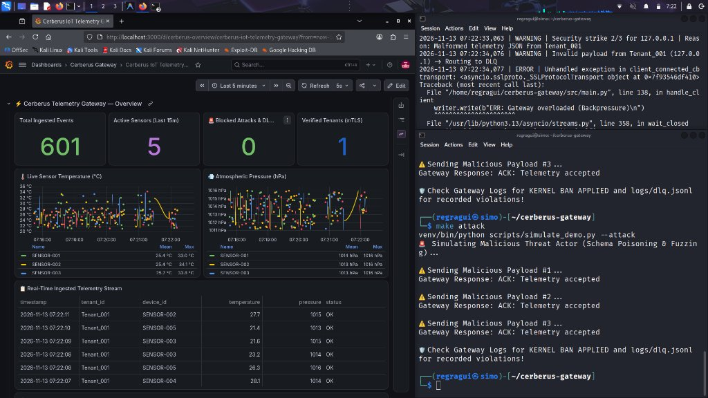

<div align="center">

<h1>🛡️ Cerberus Gateway</h1>
<p><strong>Enterprise-grade, Zero-Idle, Cryptographically Hardened IoT Telemetry Gateway</strong></p>

<p>
  
  
  
  
  
  
  
</p>

<p>
  
  
  
</p>

<p align="center">
  
</p>
<p align="center">
  <em>Real-Time IoT Telemetry Stream (TimescaleDB + Grafana) alongside Active Linux Kernel Defense (nftables)</em>
</p>

</div>

---

## 📌 Table of Contents

- [Problem Statement](#-problem-statement)
- [Architecture Overview](#-architecture-overview)
- [Core Features](#-core-features)
- [Live Observability & Security Demo](#-live-observability--security-demo)
- [Module Breakdown](#-module-breakdown)
- [Security Model](#-security-model)
- [Data Pipeline](#-data-pipeline)
- [Installation & Setup](#-installation--setup)
- [Running the Gateway](#-running-the-gateway)
- [Testing](#-testing)
- [Project Structure](#-project-structure)

---

## 🚨 Problem Statement

In large-scale **IoT and Industry 4.0** deployments, enterprises manage thousands of sensors transmitting telemetry data simultaneously. This creates three critical, interconnected challenges:

| Challenge | Consequence if Unsolved |
|---|---|
| **Concurrency at Scale** | Standard synchronous servers crash or stall under high connection loads |
| **Corrupted Data Pipelines** | Malformed JSON payloads silently poison downstream ML models and databases |
| **Public Attack Surface** | Unprotected gateways face constant DDoS, IP spoofing, and fuzzing attempts |

**Cerberus** was engineered from the ground up to solve all three simultaneously, without sacrificing performance or maintainability.

---

## 🏛️ Architecture Overview

```
┌────────────────────────────────────────────────────────────┐
│                 IoT Sensors / Clients                      │
│              (Mutual TLS Client Certificates)              │
└──────────────────────────┬─────────────────────────────────┘
                           │  TCP / mTLS (Port 8443)
                           ▼
┌────────────────────────────────────────────────────────────┐
│                    Linux OS — Kernel                       │
│                                                            │
│  cerberus.socket  ──────►  Systemd Socket Activation       │
│  (Zero-Idle: process sleeps until a connection arrives)    │
└──────────────────────────┬─────────────────────────────────┘
                           │  Inherited File Descriptor (FD 3)
                           ▼
┌────────────────────────────────────────────────────────────┐
│          cerberus@.service  (Sandboxed Process)            │
│         [DynamicUser | ProtectSystem | MemoryMax=256M]     │
│                                                            │
│   ┌─────────────────────────────────────────────────────┐  │
│   │  asyncio Event Loop  ──►  handle_client()           │  │
│   │                                                     │  │
│   │  ┌──────────────────┐   ┌────────────────────────┐  │  │
│   │  │  mTLS Verifier   │   │  Token-Bucket Limiter  │  │  │
│   │  │  (CN Extraction) │   │  (10 req / 5 per sec)  │  │  │
│   │  └────────┬─────────┘   └───────────┬────────────┘  │  │
│   │           └──────────┬──────────────┘               │  │
│   │                      ▼                              │  │
│   │        asyncio.Queue (Backpressure, max=1000)       │  │
│   │                      │                              │  │
│   │        ┌─────────────▼─────────────────────┐       │  │
│   │        │       db_consumer_worker()         │       │  │
│   │        │   Pydantic V2 Strict Validation    │       │  │
│   │        └──────┬──────────────────────┬──────┘       │  │
│   └───────────────┼──────────────────────┼──────────────┘  │
└───────────────────┼──────────────────────┼─────────────────┘
                    │ ✅ Valid              │ ❌ Invalid / Attack
                    ▼                      ▼
     ┌──────────────────────┐   ┌──────────────────────────┐
     │  TimescaleDB         │   │  Dead-Letter Queue (DLQ) │
     │  (Hypertable)        │   │  logs/dlq.jsonl          │
     │  asyncpg Pool        │   │                          │
     └──────────────────────┘   │  ActiveDefenseFirewall   │
                                │  → nftables Kernel Ban   │
                                └──────────────────────────┘
```

---

## ✨ Core Features

### ⚡ Zero-Idle Concurrency Engine
- Uses **Linux Systemd Socket Activation**: the process stays dormant (zero CPU, zero RAM) until a TCP connection arrives — the kernel handles the socket.
- Accepts connections using Python's native **`asyncio.start_server`**, handling massive concurrency on a single thread without blocking.
- **Backpressure Queue** (`asyncio.Queue(maxsize=1000)`) decouples ingestion from database I/O, preventing cascading failures under burst loads.

### 🔐 Zero-Trust mTLS Authentication
- Every client (sensor/device) must present a **valid X.509 Client Certificate** signed by the Cerberus Certificate Authority.
- The **Common Name (CN)** of the certificate is used as the `tenant_id` — cryptographically binding identity to data ownership.
- Unauthenticated connections are rejected at the TLS handshake before a single byte of application data is processed.

### 🛡️ Active Defense Kernel Firewall
- **`ActiveDefenseFirewall`** tracks security violations (malformed payloads, rate-limit abuse, non-UTF8 fuzzing, Slowloris attacks) per source IP using an in-memory sliding-window strike counter.
- Upon reaching `max_strikes` (default: 3) within `strike_window` (default: 60s), the firewall **asynchronously calls a root-owned `nftables` wrapper** via `asyncio.create_subprocess_exec` — directly dropping all packets from that IP at the **Linux kernel level**.
- The ban is tracked in-memory to prevent redundant subprocess spawns. Protected IPs (e.g., admin/monitoring) are whitelisted.

### 📐 Pydantic V2 Strict Validation
- Incoming telemetry is validated against `TelemetryPayload` with `strict=True` and `extra="forbid"`:
  - `device_id`: alphanumeric + hyphens, 3–64 chars
  - `temperature`: float, -50°C to 150°C
  - `pressure`: float, 300–1100 hPa
  - `status`: enum (`OK` / `WARNING` / `CRITICAL`)
- Invalid payloads are **never silently dropped** — they are routed to the **Dead-Letter Queue (DLQ)** and trigger a firewall strike against the sender.

### 📬 Dead-Letter Queue (DLQ)
- Malformed or schema-violating payloads are written to `logs/dlq.jsonl` as structured JSON lines (timestamp, tenant, raw payload, error type, error details).
- Written with an async lock via `asyncio.to_thread` — filesystem I/O never blocks the event loop.

### 🪣 Token-Bucket Rate Limiter
- Per-tenant rate limiting using the **Token Bucket algorithm** (capacity: 10 tokens, refill: 5/sec).
- Fully async and lock-protected. Excess requests trigger a firewall violation strike before connection is closed.

### 🗄️ TimescaleDB + asyncpg
- Valid telemetry is persisted into a **TimescaleDB Hypertable** (`telemetry`) optimized for time-series data.
- Uses an **`asyncpg` connection pool** (min: 5, max: 20 connections) for high-throughput, non-blocking database writes.
- Indexed on `(tenant_id, device_id, timestamp DESC)` for fast per-device query performance.

---

## 📂 Module Breakdown

| File | Responsibility |
|---|---|
| `src/main.py` | Asyncio event loop, mTLS server bootstrap, Systemd socket activation, graceful shutdown |
| `src/firewall.py` | `ActiveDefenseFirewall` — sliding-window strike tracker, kernel `nftables` ban integration |
| `src/models.py` | `TelemetryPayload` — Pydantic V2 strict schema with field validators |
| `src/limiter.py` | `TokenBucketLimiter` — per-tenant async rate limiter |
| `src/dlq.py` | `DeadLetterQueue` — async JSONL writer for rejected payloads |
| `src/database.py` | `Database` — asyncpg connection pool lifecycle manager |
| `src/repository.py` | `TelemetryRepository` — typed SQL queries (insert, batch insert, fetch latest) |
| `config/init.sql` | TimescaleDB schema: hypertable creation + composite index |
| `config/generate_certs.sh` | Bash script: generates CA, server, and client X.509 certificates (mTLS) |
| `config/setup_firewall.sh` | Bash script: initializes `nftables` table and chain for IP banning |
| `systemd/cerberus.socket` | Systemd socket unit — kernel-managed listener for socket activation |
| `systemd/cerberus@.service` | Sandboxed service template: `DynamicUser`, `ProtectSystem`, `MemoryMax=256M` |
| `docker-compose.yml` | Spins up TimescaleDB (pg16) with volume persistence and health checks |
| `tests/test_gateway.py` | 6 pytest-asyncio tests: schema validation, DLQ writes, rate limiter, firewall logic |

---

## 🔐 Security Model

Cerberus implements a **Defense-in-Depth** strategy with four independent, overlapping layers:

```
Layer 1 — Network Identity:  mTLS (Client Certificate)
Layer 2 — Rate Control:      Token-Bucket Limiter (per Tenant CN)
Layer 3 — Data Integrity:    Pydantic V2 Strict Schema Validation
Layer 4 — Active Repulsion:  nftables Kernel-level IP Auto-Ban
```

No single layer failure compromises the system. A malformed payload does not cause a crash — it generates a DLQ entry and a firewall strike. Rate abuse does not corrupt data — it triggers an escalating ban.

---

## 🔄 Data Pipeline

```
Sensor  ──(mTLS TCP)──►  handle_client()
                              │
                    [1] Rate Limit Check (TokenBucket)
                              │ PASS
                    [2] UTF-8 Decode & Sanitize
                              │
                    [3] queue.put_nowait()  → ACK sent to sensor
                              │
              ┌───── asyncio.Queue ──────┐
              │   db_consumer_worker()   │
              │                         │
              │  [4] Pydantic V2 Parse  │
              │       ┌────┴────┐       │
              │    VALID     INVALID    │
              │       │         │       │
              │  [5] INSERT   [5] DLQ   │
              │  TimescaleDB  record +  │
              │  Hypertable   FW strike │
              └─────────────────────────┘
```

---

## ⚙️ Installation & Setup

### Prerequisites

- Python 3.11+
- Docker & Docker Compose
- Linux with `nftables` and `systemd` (for production mode)
- `openssl` (for certificate generation)

### 1. Clone & Create Virtual Environment

```bash
git clone https://github.com/Regragui-Mohammed/cerberus-gateway.git
cd cerberus-gateway
python3 -m venv venv
source venv/bin/activate
pip install asyncpg pydantic pytest pytest-asyncio
```

### 2. Start TimescaleDB & Grafana Observability Dashboard

```bash
docker compose up -d
# Verify both containers (TimescaleDB + Grafana) are healthy:
docker compose ps
```
> 📊 **Grafana Live Dashboard:** Open [http://localhost:3000](http://localhost:3000) (Login: `admin` / `admin`).  
> The dashboard **"Cerberus IoT Telemetry Gateway"** is automatically provisioned and ready out-of-the-box!

### 3. Generate mTLS Certificates

```bash
chmod +x config/generate_certs.sh
./config/generate_certs.sh
# Outputs: config/certs/ca.pem, server.pem, server.key, client.pem, client.key
```

### 4. Initialize Firewall (Linux / Production)

```bash
sudo chmod +x config/setup_firewall.sh
sudo ./config/setup_firewall.sh
```

---

## 🚀 Running the Gateway

### Standalone Mode (Development)

```bash
source venv/bin/activate
python -m src.main
# Output:
# 2026-11-12 18:47:00 | INFO | Cerberus Gateway listening on 0.0.0.0:8443 (Standalone mTLS)
```

### Production Mode (Systemd Socket Activation)

```bash
sudo cp systemd/cerberus.socket /etc/systemd/system/
sudo cp systemd/cerberus@.service /etc/systemd/system/
sudo systemctl daemon-reload
sudo systemctl enable --now cerberus.socket
# The process starts on-demand; zero RAM consumed at idle.
```

### Send a Valid Test Payload

```bash
echo '{"device_id":"SENSOR-001","timestamp":"2026-11-12T18:00:00Z","temperature":22.5,"pressure":1013.25,"status":"OK"}' \
  | openssl s_client -connect localhost:8443 \
      -cert config/certs/client.pem \
      -key config/certs/client.key \
      -CAfile config/certs/ca.pem \
      -quiet 2>/dev/null
# Expected response: ACK: Telemetry accepted
```

### Simulate an Attack (DLQ + nftables Auto-Ban Demo)

```bash
# Send 3 malformed payloads → triggers kernel-level IP ban
for i in 1 2 3; do
  echo '{"device_id":"X","temperature":"HACKED","pressure":-999}' \
    | openssl s_client -connect localhost:8443 \
        -cert config/certs/client.pem -key config/certs/client.key \
        -CAfile config/certs/ca.pem -quiet 2>/dev/null
done

# Verify the kernel ban was applied:
sudo nft list ruleset | grep drop

# Inspect the Dead-Letter Queue:
cat logs/dlq.jsonl | python3 -m json.tool
```

---

## 🧪 Testing

The test suite covers all 4 core subsystems using `pytest-asyncio`:

```bash
source venv/bin/activate
pytest tests/ -v
```

**Expected output:**

```
tests/test_gateway.py::test_telemetry_payload_valid                   PASSED
tests/test_gateway.py::test_telemetry_payload_rejects_corrupted_types PASSED
tests/test_gateway.py::test_dlq_records_malformed_payload             PASSED
tests/test_gateway.py::test_token_bucket_burst_and_refill             PASSED
tests/test_gateway.py::test_firewall_bans_after_max_strikes           PASSED
tests/test_gateway.py::test_firewall_ignores_protected_ips            PASSED

6 passed in X.XXs
```

**Coverage by component:**

| Test | What is Verified |
|---|---|
| `test_telemetry_payload_valid` | Well-formed JSON is accepted by Pydantic V2 |
| `test_telemetry_payload_rejects_corrupted_types` | Type-corrupted fields (string as float) raise `ValidationError` |
| `test_dlq_records_malformed_payload` | Rejected payload is written as valid JSONL with correct fields |
| `test_token_bucket_burst_and_refill` | Burst limit is enforced; tokens refill at correct rate after `sleep` |
| `test_firewall_bans_after_max_strikes` | 3rd strike calls `nftables` wrapper subprocess with correct args |
| `test_firewall_ignores_protected_ips` | Whitelisted IPs never trigger a ban subprocess |

---

## 📸 Live Observability & Security Demo

### 1. 📊 Grafana Observability Dashboard
The gateway provides real-time observability over all telemetry streams, active tenants, sensor status anomalies, and kernel security violations:

```
[ Grafana Dashboard: http://localhost:3000/d/cerberus-overview ]
• Total Ingested Events Counter (1,000+ non-blocking writes via asyncpg)
• Real-time Temperature (°C) & Pressure (hPa) continuous time-series curves
• Active Multi-Tenant Sensor Health Status table
• Live Security Strike & Kernel Blackhole event table
```

---

### 2. ⚡ High-Throughput Concurrent Ingestion
Legitimate IoT sensors continuously transmit cryptographically verified telemetry over Mutual TLS:

```text
[0042] Sent SENSOR-005 | Temp: 27.30°C | Status: OK      -> ACK: Telemetry accepted
[0043] Sent SENSOR-004 | Temp: 25.12°C | Status: OK      -> ACK: Telemetry accepted
[0044] Sent SENSOR-002 | Temp: 24.87°C | Status: OK      -> ACK: Telemetry accepted
[0045] Sent SENSOR-005 | Temp: 27.63°C | Status: OK      -> ACK: Telemetry accepted
[0046] Sent SENSOR-004 | Temp: 27.00°C | Status: OK      -> ACK: Telemetry accepted
[0047] Sent SENSOR-004 | Temp: 33.78°C | Status: WARNING -> ACK: Telemetry accepted
```

---

### 3. 💥 Active Defense in Action (Auto-Ban via nftables)
When a threat actor attempts schema poisoning, binary fuzzing, or rate-limit abuse:

```text
2026-11-13 07:22:32,050 | WARNING | Security strike 1/3 for 127.0.0.1 | Reason: Malformed telemetry JSON from Tenant_001
2026-11-13 07:22:33,063 | WARNING | Security strike 2/3 for 127.0.0.1 | Reason: Malformed telemetry JSON from Tenant_001
2026-11-13 07:22:34,076 | WARNING | Security strike 3/3 for 127.0.0.1 | Reason: Malformed telemetry JSON from Tenant_001
2026-11-13 07:22:34,080 | CRITICAL | KERNEL BAN APPLIED: 127.0.0.1 blackholed for 10m | Reason: Security policy violation
```

---

### 4. 📬 Dead-Letter Queue (DLQ) Sample Output
Rejected payloads are never dropped silently; they are serialized into `logs/dlq.jsonl` with cryptographic tenant identity and Pydantic validation trace:

```json
{
  "timestamp": "2026-11-13T07:29:46.106035+00:00",
  "tenant_id": "Tenant_001",
  "error_type": "ValidationError",
  "error_details": "1 validation error for TelemetryPayload\ntemperature\n  Input should be a valid number, unable to parse string as a number [type=float_parsing, input_value='CORRUPTED_STRING']",
  "raw_payload": "{\"device_id\": \"SENSOR-EVIL\", \"temperature\": \"CORRUPTED_STRING\", \"pressure\": 1013.25}"
}
```

---

### 5. 🧪 Test Suite Execution
Rigorous test coverage validating schema invariants, DLQ persistence, rate-limiting refill mechanics, and subprocess kernel execution:

```text
============================= test session starts ==============================
platform linux -- Python 3.13.11, pytest-9.2.0, pluggy-1.7.0
plugins: asyncio-1.5.0
collected 6 items

tests/test_gateway.py::test_telemetry_payload_valid                   PASSED [ 16%]
tests/test_gateway.py::test_telemetry_payload_rejects_corrupted_types PASSED [ 33%]
tests/test_gateway.py::test_dlq_records_malformed_payload             PASSED [ 50%]
tests/test_gateway.py::test_token_bucket_burst_and_refill             PASSED [ 66%]
tests/test_gateway.py::test_firewall_bans_after_max_strikes           PASSED [ 83%]
tests/test_gateway.py::test_firewall_ignores_protected_ips            PASSED [100%]

============================== 6 passed in 0.70s ===============================
```

---

## 📁 Project Structure

```
cerberus-gateway/
├── config/
│   ├── generate_certs.sh       # mTLS CA + Client/Server certificate generation
│   ├── setup_firewall.sh       # nftables table/chain initialization
│   ├── init.sql                # TimescaleDB hypertable schema
│   └── certs/                  # Generated .pem and .key files (gitignored)
├── src/
│   ├── main.py                 # Asyncio engine, mTLS server, Systemd activation
│   ├── firewall.py             # ActiveDefenseFirewall — nftables integration
│   ├── models.py               # TelemetryPayload — Pydantic V2 strict schema
│   ├── limiter.py              # TokenBucketLimiter — per-tenant rate control
│   ├── dlq.py                  # DeadLetterQueue — async JSONL failure logger
│   ├── database.py             # asyncpg connection pool manager
│   └── repository.py          # Typed TimescaleDB query repository
├── systemd/
│   ├── cerberus.socket         # Systemd socket unit (kernel-managed listener)
│   └── cerberus@.service       # Sandboxed service template (DynamicUser, cgroup v2)
├── tests/
│   └── test_gateway.py         # 6 pytest-asyncio tests (validation, DLQ, limiter, firewall)
├── logs/
│   └── dlq.jsonl               # Dead-letter queue output (auto-created at runtime)
├── docker-compose.yml          # TimescaleDB pg16 with volume + health check
└── pyproject.toml              # pytest config (asyncio_mode=auto)
```

---

## 📄 License

MIT License — see [LICENSE](LICENSE) for details.

---

<div align="center">
  <sub>Built with 🛡️ — engineered for the kernel, not the framework.</sub>
</div>
